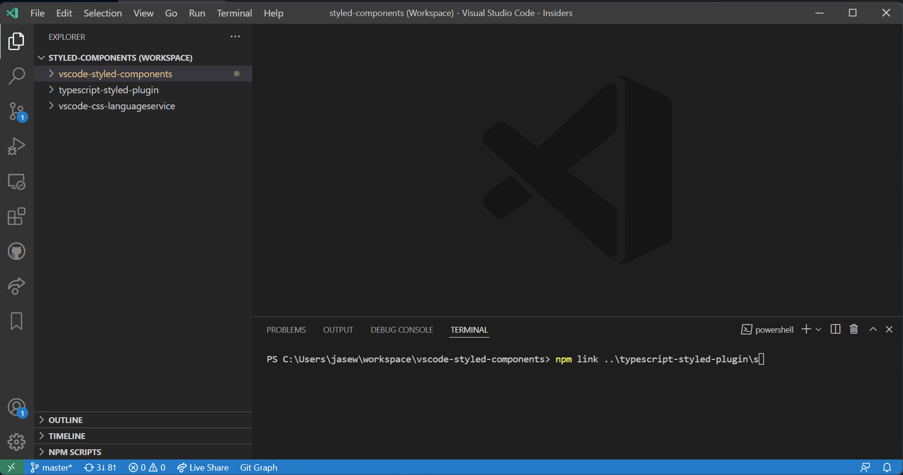

# Contributing

Start off forking, then cloning the project locally. The scripts need Node 22.18 or newer (`devEngines` in `package.json`), which runs TypeScript files directly:

- `$ npm ci` - Install dependencies
- `$ npm test` - Run tests
- `$ npm run format` - Format any changes you've made with prettier
- `$ npm run lint` - Check formatting with prettier
- `$ npx changeset` - Describe a user-facing change for the changelog (see [Releasing](#releasing))

## Syntax

The grammars are TextMate grammars written as TypeScript in `syntaxes/src/`:

- `styled-components.mts`: the injection grammar, which finds styled-components tags in JavaScript and TypeScript and starts CSS at the template's backtick
- `css.styled.mts`: the CSS grammar for template content
- `ownCss.mts`: copies the CSS rules `css.styled.mts` uses from `css.tmLanguage.json`, VS Code's CSS grammar (vendored from the pinned VS Code version; its license is in `ThirdPartyNotices.txt`)

`syntaxes/src/generate.mts` writes `syntaxes/styled-components.json` and `syntaxes/css.styled.json`. Every build, `npm run watch`, and `npm run tokenize` (except with `--grammars <dir>`) regenerates them; they are git-ignored, so edit the `.mts` sources, never the JSON.

The regexes are written with `String.raw`, so they need no JSON escaping. VS Code runs them with [Oniguruma](https://github.com/kkos/oniguruma), not JavaScript's regex engine; Oniguruma is closest to the PCRE flavor on [regex101.com](https://regex101.com/). Check a change with `npm run tokenize`, which runs the real grammars.

The order of the patterns arrays matters: TextMate tries the rules in order, so reordering them changes highlighting.

To see your changes in the editor, press `F5` with this project open in VS Code. A second window opens with the extension enabled and the colorize fixtures folder loaded.

Refer to JS/TS tokens syntax at https://github.com/microsoft/vscode/tree/master/extensions under `<language>/syntaxes/<lang>.tmLanguage.json`.

To check how tokens are being matched, select "Developer: Inspect Editor Tokens and Scope" under Command Palette.

### "A line break seems to break the syntax highlighting"

A TextMate grammar [matches one line at a time](https://github.com/microsoft/vscode-textmate/issues/32), so a regex that needs to see a newline never matches. Issues [#266](https://github.com/styled-components/vscode-styled-components/issues/266) and [#277](https://github.com/styled-components/vscode-styled-components/issues/277) are examples.

The best fix is to look at the new line and add a rule to `syntaxes/src/styled-components.mts` that matches that line as closely as possible while staying generic.

## Intellisense

Intellisense is handled by the bundled `@styled/typescript-styled-plugin` (https://github.com/styled-components/typescript-styled-plugin).

For most things `typescript-styled-plugin` is just a [pass-through](https://github.com/microsoft/typescript-styled-plugin/blob/master/src/_language-service.ts#L87-L95) to the CSS/SCSS language services. For example, looking at [getCompletionItems](https://github.com/styled-components/typescript-styled-plugin/blob/master/src/_language-service.ts#L215-L244) you can see it just calls the equivalent on the upstream language services. So if something works natively (CSS file), but not in styled-components its most likely because it's not passing the correct events through.

### Setting up

Load `typescript-styled-plugin`, `vscode-styled-components`, and optionally [`vscode-css-languageserver`](https://github.com/vscode-langservers/vscode-css-languageserver) as the folders of one VS Code multi-root workspace (see the image above).

You can't run the typescript-styled-plugin directly, instead you need to load a debugger to listen on a port. The below shows you how to set this up so that you can debug both the extension and the plugin at the same time.

- Make sure `typescript-styled-plugin` is yarn|npm linked into `vscode-styled-components` (see image above)
- While debugging, add `"plugins": [{ "name": "../typescript-styled-plugin" }]` under `compilerOptions` in `tsconfig.json`, with the path pointing to your local checkout of the plugin. Don't commit it.
- In `vscode-styled-components/.vscode/launch.json`, `"TSS_DEBUG": "9229"` should be set (or `"TSS_REMOTE_DEBUG": "9229"` if using WSL). This allows the debugger to communicate with the typescript-styled-plugin. These may already be set.
- [Debug Tab] Click `Launch Extension`
- Once the new window is up and running go back to the host VSCode instance and on the debug tab Click `Debug Styled Plugin` - This will both build and start the debugger on the typescript-styled-plugin project.

You should now be able to use styled-components in the guest window and set breakpoints on the both the plugin and extension in the main window.

A good starting point is setting a breakpoint [here](https://github.com/styled-components/typescript-styled-plugin/blob/4f6ad2aae15098d74fd069d646a44ae368986af4/src/_language-service.ts#L254) then trying to use completions in the guest window.

[Optional] - If you want to go even deeper and debug the css language server, you will need to yarn|npm link that into typescript plugin and then make sure typescript-plugin's [outfiles](https://github.com/styled-components/typescript-styled-plugin/blob/main/.vscode/launch.json#L9) are also pointing to the css language server's generated files on build.

More Info:

- [Example of debugging Styled Plugin](https://github.com/microsoft/typescript-styled-plugin/pull/156)
- https://github.com/microsoft/typescript-styled-plugin/issues/120#issuecomment-707400103
- https://github.com/microsoft/TypeScript/wiki/Writing-a-Language-Service-Plugin#testing-locally
- https://github.com/microsoft/TypeScript/wiki/Debugging-Language-Service-in-VS-Code#debugging-tsserver-server-side

### Logging

If you want logging, you can set `"typescript.tsserver.log": "verbose"` in your global settings (or local guest settings) and view the output, there should be a path to a log file that's printed out. Any console.log you do from the plugin will end up in there.

## Tests

You can run tests simply by running `npm test`.
This should spawn another instance of VSCode to run the end to end tests in.

The syntax tests will generate tokens for [fixtures we have](./src/tests/suite/colorize-fixtures) which are then compared to the results (adjacent folder). If there are changes and the tests fail it will generate a new result (overwriting the previous one). A failing CI run uploads the regenerated results as a `colorize-results-<os>` artifact.

The tests run against the VS Code version pinned in [vscodeVersion.mts](./src/tests/vscodeVersion.mts), because built-in themes and grammars change between releases. To move to a newer VS Code, bump the pin, replace `syntaxes/src/css.tmLanguage.json` with that version's `extensions/css/syntaxes/css.tmLanguage.json`, run the tests, review the regenerated results, and commit them together.

A syntax change updates the test suite. Every fixture except a `.css` fixture ends with `const sentinel = 1;`; a fixture without that last line fails the colorization test, and if highlighting leaks out of a template, a sentinel line loses its plain-code scopes and the test fails.

To check a grammar change without opening VS Code, run `npm run tokenize -- <files>`. It prints every token's scopes using the pinned VS Code's grammars; add `--sentinel` to check only the sentinel lines (it also fails a fixture without the last sentinel line, and prints `SKIP` for a `.css` file), or `--drift` to compare each fixture with its committed result. A grammar change must not slow highlighting; `npm run bench:grammar` measures it (both tools: [spec, "Test strategy"](docs/spec.md#test-strategy)).

Logic that needs no editor (parsing, scanning, grammar generation) gets unit tests in `src/**/*.test.ts` or `syntaxes/src/**/*.test.ts`, run with `npm run test:unit`.

## Commit messages

Commit messages and PR titles follow [Conventional Commits](https://www.conventionalcommits.org/): `type(scope): subject`, for example `fix(grammar): stop highlighting after an empty template`. The types are feat, fix, perf, refactor, style, test, docs, build, ci, chore, and revert; the scope is optional and holds lowercase letters, digits, and hyphens (`fix(color-picker): ...`), and a `!` after the type or scope marks a breaking change (`feat(grammar)!: ...`). A squash merge uses the PR title as the commit message, so the title follows the same format.

`scripts/check-commit-message.sh` checks a message. The commit-msg hook runs it on each local commit, and the "Commit messages" CI job (`.github/workflows/commit-messages.yml`) runs it on the PR title and every commit in the PR, again whenever the PR title is edited. The hook also accepts the subjects git writes itself (`fixup! `, `squash! `, `amend! `, and `Revert "..."`); CI does not, so squash or reword those commits before merging.

## Releasing

Every PR with a user-facing change includes a changeset (`npx changeset`, choose patch, minor, or major, and describe the change for users). On merge to `main`, the Release workflow opens or updates a "chore: version packages" PR that bumps the version and writes `CHANGELOG.md`. Merging that PR publishes the extension to the VS Code Marketplace through trusted publishing (no stored token), tags `vX.Y.Z`, and creates the GitHub release.
